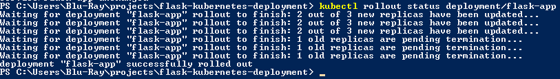
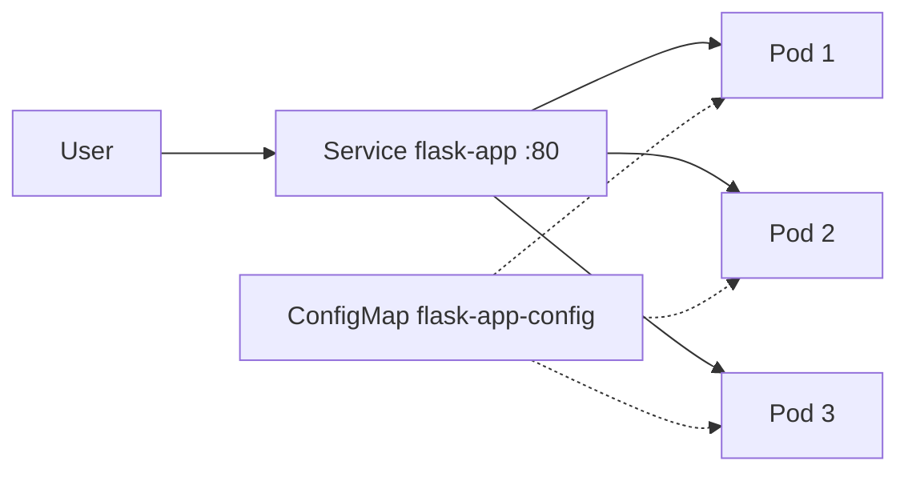

# Flask on Kubernetes


A small Flask app deployed to Kubernetes with a Deployment, a Service and a ConfigMap, running on a local [kind](https://kind.sigs.k8s.io/) cluster. A GitHub Actions pipeline tests the app and then deploys it to a temporary kind cluster on every push, so a broken manifest or image is caught before anyone uses it.



## Architecture



- **Deployment** keeps 3 replicas of the app running and handles updates.
- **Service** gives the pods one stable address and spreads requests between them.
- **ConfigMap** holds the settings (`APP_MESSAGE`, `APP_ENV`), so they can change without rebuilding the image.

## Design choices

- **Readiness probe on `/health`:** a pod only receives traffic once it answers, which is what makes rolling updates safe.
- **Liveness probe:** Kubernetes restarts a container that stops answering.
- **Resource requests and limits:** each pod has a guaranteed minimum and a maximum, so one pod cannot starve the others.
- **Explicit image tags (`flask-k8s:2.0`), never `latest`:** you always know which code is running, and rollbacks are predictable.
- **`imagePullPolicy: IfNotPresent`:** the cluster uses the image loaded into it instead of trying to pull from the internet.

## CI pipeline

On every push and pull request, `.github/workflows/ci.yml` runs two jobs:

1. **test:** installs dependencies and runs pytest.
2. **deploy-test** (only if tests pass): builds the image named in `k8s/deployment.yaml`, creates a temporary kind cluster, loads the image, applies the manifests, waits for the rollout to finish and calls `/health` and `/` as a smoke test. If anything fails, it prints pod details and logs to help with debugging.

The image name is read from the Deployment file, so the pipeline follows along when the version changes.

## Project structure

```
.
├── .github/workflows/ci.yml
├── k8s
│   ├── configmap.yaml
│   ├── deployment.yaml
│   └── service.yaml
├── docs
│   └── rolling-update.png
├── tests
│   └── test_app.py
├── app.py
├── Dockerfile
└── requirements.txt
```

## Run it locally

Prerequisites: Docker, [kind](https://kind.sigs.k8s.io/) and [kubectl](https://kubernetes.io/docs/tasks/tools/).

```bash
git clone https://github.com/MohamedHabiba99/flask-kubernetes-deployment.git
cd flask-kubernetes-deployment

kind create cluster --name demo
docker build -t flask-k8s:2.0 .
kind load docker-image flask-k8s:2.0 --name demo
kubectl apply -f k8s/
kubectl rollout status deployment/flask-app
kubectl port-forward service/flask-app 8082:80
```

Open `http://localhost:8082`. The reply shows the ConfigMap values and the name of the pod that answered.

Clean up with `kind delete cluster --name demo`.

## Try a rolling update and a rollback

Build a new image with a new tag, load it into the cluster and change the `image:` line in `k8s/deployment.yaml`. Then:

```bash
kubectl apply -f k8s/
kubectl rollout status deployment/flask-app   # pods are replaced one at a time
kubectl rollout undo deployment/flask-app     # go back to the previous version
```

Because of the readiness probe, there are always pods serving traffic during the update.

## Limitations

- The image is loaded straight into kind with `kind load`. A real setup would push it to a registry (for example GitHub Container Registry) and the cluster would pull from there.
- The Service is `ClusterIP`, so it is reached with `kubectl port-forward`. A real cluster would add an Ingress or a LoadBalancer.

## What I learned

- How a Deployment, a Service and a ConfigMap work together, and how labels connect them
- Why readiness probes make rolling updates safe, and how to roll back a release with `kubectl rollout undo`
- How to test Kubernetes manifests in CI by creating a temporary kind cluster inside GitHub Actions